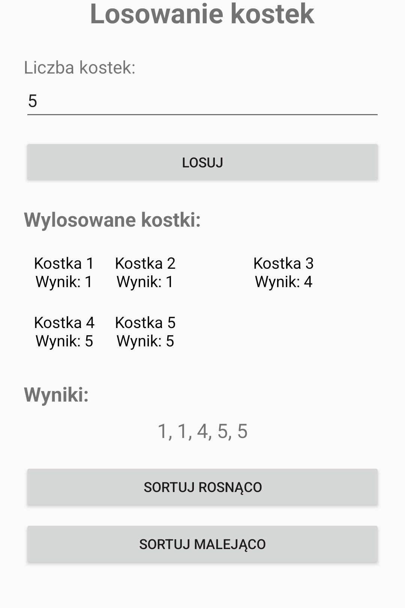

<div align="center">

# 🎲 Losowanie Kostek

**Aplikacja Android do losowania dowolnej liczby kości i sortowania wyników.**

[](https://developer.android.com)
[](https://www.java.com)
[](https://gradle.org)
[](app/src/main/res/layout/activity_main.xml)

</div>

---

## 📋 Spis treści

- [Opis](#-opis)
- [Zrzut ekranu](#-zrzut-ekranu)
- [Funkcje](#-funkcje)
- [Technologie](#-technologie)
- [Wymagania](#-wymagania)
- [Uruchomienie](#-uruchomienie)
- [Jak korzystać](#-jak-korzystać)
- [Struktura projektu](#-struktura-projektu)
- [Jak to działa](#-jak-to-działa)
- [Możliwe rozszerzenia](#-możliwe-rozszerzenia)

## 📖 Opis

Projekt zaliczeniowy z przedmiotu **Aplikacje Mobilne**. Aplikacja powstała w Android Studio
z użyciem języka **Java** i interfejsu zdefiniowanego w **XML**.

Użytkownik podaje liczbę kości, a aplikacja losuje dla każdej z nich wynik od 1 do 6.
Wyniki są prezentowane w czytelnej siatce oraz w formie listy. Dodatkowo można je
posortować rosnąco lub malejąco bez ponownego losowania.

## 📱 Zrzut ekranu

<p align="center">
  
</p>

<p align="center">
  <em>Widok po wylosowaniu pięciu kości i sortowaniu rosnąco.</em>
</p>

## ✨ Funkcje

- 🎲 Losowanie dowolnej liczby kości (każda kość ma 6 ścianek).
- 🔢 Walidacja danych wejściowych:
  - puste pole,
  - wartość niebędąca liczbą całkowitą,
  - liczba mniejsza lub równa zero.
- 📊 Czytelna siatka wyników (maksymalnie 3 kości w rzędzie).
- ⬆️ Sortowanie rosnące bez ponownego losowania.
- ⬇️ Sortowanie malejące bez ponownego losowania.
- 💬 Komunikaty `Toast` informujące o błędach i braku wyników.

## 🛠️ Technologie

| Technologia | Wersja / szczegóły |
|---|---|
| Język | Java 11 |
| Android SDK | compileSdk 36, targetSdk 36 |
| Minimalna wersja Androida | API 24 (Android 7.0) |
| Android Gradle Plugin | 8.12.3 |
| Gradle | 8.13 (wrapper) |
| Biblioteki | AndroidX AppCompat 1.6.1 |
| Interfejs | XML (`activity_main.xml`) |

## ✅ Wymagania

- **Android Studio** (zalecana aktualna wersja) lub JDK 17+ i Android SDK.
- Zainstalowany **Android SDK Platform 36**.
- Emulator lub urządzenie z Androidem 7.0 (API 24) lub nowszym.

## 🚀 Uruchomienie

### Android Studio

1. Otwórz Android Studio i wybierz **File → Open…**.
2. Wskaż katalog `LosowanieKostek` (nie katalog główny repozytorium).
3. Poczekaj na synchronizację Gradle.
4. Uruchom aplikację przyciskiem **Run ▶**.

### Wiersz poleceń

```bash
# Windows
gradlew.bat assembleDebug

# Linux / macOS
./gradlew assembleDebug
```

Gotowy plik APK znajdziesz w:

```
app/build/outputs/apk/debug/app-debug.apk
```

## 🕹️ Jak korzystać

1. Wpisz liczbę kości w polu **Liczba kostek:** (domyślnie `5`).
2. Naciśnij **LOSUJ** — aplikacja wylosuje wyniki od 1 do 6.
3. Opcjonalnie naciśnij **SORTUJ ROSNĄCO** lub **SORTUJ MALEJĄCO**.
4. Ponowne naciśnięcie **LOSUJ** zastąpi poprzednie wyniki nowymi.

## 🗂️ Struktura projektu

```
LosowanieKostek/
├── app/
│   ├── build.gradle.kts
│   └── src/
│       └── main/
│           ├── AndroidManifest.xml
│           ├── java/com/example/losowaniekostek/
│           │   └── MainActivity.java      ← interfejs, walidacja, losowanie i sortowanie
│           └── res/
│               ├── layout/activity_main.xml
│               └── values/strings.xml
├── docs/
│   └── screenshot.png
├── build.gradle.kts
├── settings.gradle.kts
└── gradlew / gradlew.bat
```

## ⚙️ Jak to działa

### Walidacja

`MainActivity` sprawdza dane z pola tekstowego przed uruchomieniem losowania.
Dzięki temu puste pole, tekst lub liczba niedodatnia kończą się czytelnym komunikatem
zamiast wyjątku.

### Losowanie

Po walidacji tworzona jest tablica wyników, a każda kość otrzymuje wartość z zakresu `1–6`:

```java
wyniki = new int[liczbaKostek];
for (int i = 0; i < liczbaKostek; i++) {
    wyniki[i] = random.nextInt(6) + 1;
}
```

### Sortowanie

Wyniki są sortowane algorytmem bąbelkowym, bez tworzenia nowej tablicy:

- **rosnąco** — gdy element po lewej jest większy od elementu po prawej,
- **malejąco** — gdy element po lewej jest mniejszy od elementu po prawej.

Po każdej operacji `MainActivity` odświeża siatkę kości oraz tekst z wynikami.

### Warstwa interfejsu

`activity_main.xml` definiuje przewijany ekran z polem na liczbę kości, przyciskiem
**LOSUJ**, kontenerem `GridLayout` na kości, podsumowaniem wyników oraz dwoma
przyciskami sortowania. Pojedyncze kości są dodawane dynamicznie z kodu.

## 🗺️ Możliwe rozszerzenia

- [ ] Zapis historii losowań.
- [ ] Wybór liczby ścianek (np. k4, k8, k20).
- [ ] Animacja rzutu kością.
- [ ] Tryb ciemny i motyw Material Design.
- [ ] Wydzielenie logiki do osobnej klasy i testy jednostkowe.

---

<div align="center">

Projekt edukacyjny — **Aplikacje Mobilne** · [Repozytorium](https://github.com/LuminousDeveloper/Aplikacje-Mobilne)

</div>
